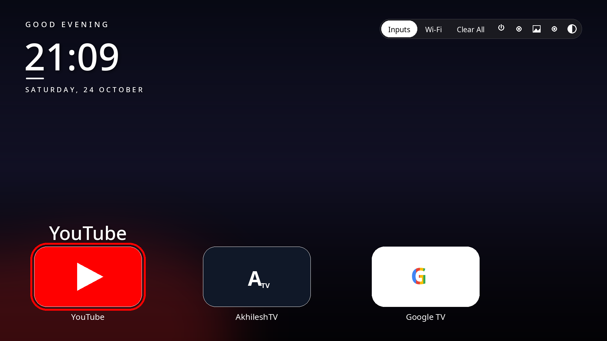
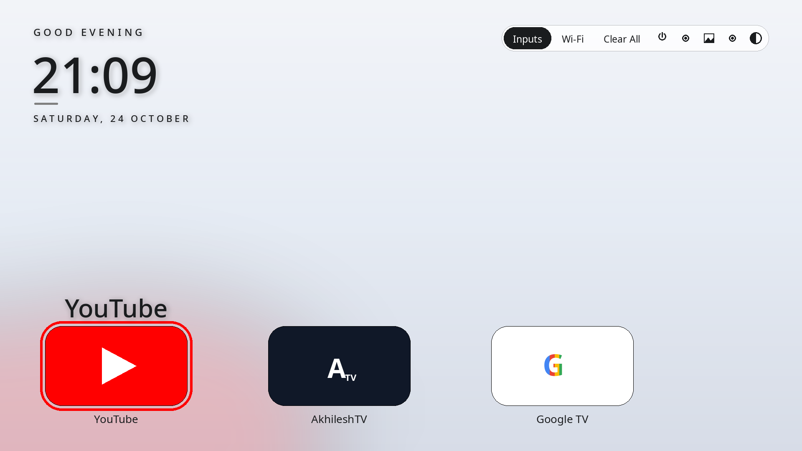

# Material TV Launcher

A Material 3 launcher for Android TV and Google TV, built for Xiaomi Mi TV.

A fluid, content-first home screen: your favourite apps in a dock, every app in a
grid below, a tonal top-bar strip for quick actions, and colours that follow the
app you are on. Dark and light themes are built in and switch from the remote.

> Inspired by [0xRampey/material-tv-launcher](https://github.com/0xRampey/material-tv-launcher).
> This is an independent implementation written for this launcher's own feature
> set — it is not a fork, and it is not affiliated with or endorsed by Google
> or by 0xRampey.

## Screenshots

### Dark theme (default)



### Light theme



## What you get

- **Material 3 Expressive design** — 16:9 cards with 20 dp corners, a tonal
  top-bar strip, a focus ring in the focused app's own colour, and Google Sans
  Flex typography.
- **Dark and light themes** — press the Theme button (last icon in the top-bar
  strip) to switch. The choice is remembered across restarts.
- **Your apps, your way** — a dock of favourite apps (YouTube, AkhileshTV and
  Google TV by default) plus an All Apps grid underneath.
- **Hide apps and Add to Home** — long-press OK on any app to hide it from the
  grid or pin it to the dock. Hidden apps live under the Hidden-apps button.
- **Photo wallpapers** — rotating background photos, sent from your phone over
  the launcher's built-in page (see below).
- **Top-bar strip** — Inputs, Wi-Fi, Clear All (kills background apps), Power,
  Settings, Wallpaper (next photo now), Hidden-apps and Theme.
- **Phone remote page** — while the TV is on, open the launcher's page from
  your phone's browser on the same Wi-Fi network to control the TV and manage
  wallpapers.
- **Private by design** — the launcher has no internet permission. Nothing it
  reads leaves the TV.

## Install on your TV

No laptop needed — a phone and the TV are enough.

1. Download the APK from the
   [Releases](https://github.com/Akhilesh2412/MaterialTV-Launcher/releases)
   page (or build it yourself, below).
2. Send the APK to the TV with **Send Files to TV** (or any file-transfer app).
   It lands in `/sdcard/Download`.
3. On the TV, open **Remote ADB Shell** (or any ADB shell app) and connect to
   the TV itself:
   ```
   pm install -r /sdcard/Download/MaterialTV-Launcher.apk
   ```
4. Press Home. If the TV asks which home app to use, pick this launcher and
   choose **Always**.
5. To go back to the stock launcher later, open Settings → Apps → this
   launcher → Clear defaults, then press Home again.

## Build it yourself

Requirements: JDK 17, Android SDK with API 34 and build-tools 34.0.0.

```bash
./gradlew assembleDebug
# APK: app/build/outputs/apk/debug/app-debug.apk
```

The build uses only `google()` and `mavenCentral()` repositories. The original
development setup also resolved dependencies from a pre-fetched offline Maven
repository; that local path is intentionally not part of this repo.

## Configure it

Everything lives in `app/src/main/res/values/config.xml`:

| Setting | What it does |
| --- | --- |
| `dock_packages` | Apps pinned to the dock, in order. `YOUTUBE_ALIAS` stands for the YouTube app (renamed to "YouTube" on screen). |
| `hidden_packages` | Apps hidden from the grid by default. |
| `columns` | Apps per row in the dock and the grid (3–6). |
| `use_wallpaper` | Photo wallpapers on/off. |
| `greeting_name` | Name shown in the greeting ("Good evening, Sam"). Leave empty for no name. |

Hidden apps and dock pins are also stored on the device (SharedPreferences
`hidden_apps` / `home_apps`) and survive updates.

## Privacy

- No internet permission. The launcher cannot send anything anywhere.
- Wallpapers are photos you send from your own phone; they stay on the TV.
- No accounts, no analytics, no ads.

## Credits

- Design inspiration: [0xRampey/material-tv-launcher](https://github.com/0xRampey/material-tv-launcher)
  (Apache 2.0).
- Typography: [Google Sans Flex](https://fonts.google.com/specimen/Google+Sans+Flex)
  (SIL Open Font License 1.1, see `app/src/main/assets/fonts/GoogleSansFlex-OFL.txt`).
- "Google", "Google TV" and "Material Design" belong to Google. This project is
  not affiliated with or endorsed by Google.

## Terms

See [TERMS.md](TERMS.md) for the terms and conditions of use.

## License

This project is currently all rights reserved. A license will be added soon.
